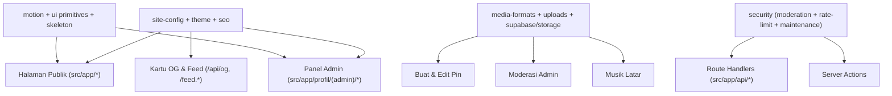

# Arsitektur & Desain Teknis

Dokumen ini menjelaskan arsitektur **Pola Sarang Laba-Laba** yang menjadi fondasi
**Ruang Bersama**, pemetaan setiap folder di `src/`, alur media, lapisan keamanan,
dan keputusan teknis utama. Untuk panduan instalasi dan mulai cepat, lihat
[`README.md`](../README.md).

---

## Daftar isi

- [1. Pola Sarang Laba-Laba](#1-pola-sarang-laba-laba)
- [2. Peta direktori `src/`](#2-peta-direktori-src)
- [3. Pusat logika utama (`src/lib/`)](#3-pusat-logika-utama-srclib)
- [4. Sistem UI, Motion, dan Skeleton (`src/components/`)](#4-sistem-ui-motion-dan-skeleton-srccomponents)
- [5. Alur media, format, dan batas ukuran](#5-alur-media-format-dan-batas-ukuran)
- [6. Keamanan berlapis](#6-keamanan-berlapis)
- [7. SEO, Feed, dan Open Graph](#7-seo-feed-dan-open-graph)
- [8. Database & migrasi idempoten](#8-database--migrasi-idempoten)
- [9. Catatan versi dependensi](#9-catatan-versi-dependensi)

---

## 1. Pola Sarang Laba-Laba

Seluruh codebase mengikuti satu prinsip utama (lihat juga [`AGENTS.md`](../AGENTS.md)):
**satu pusat logika melayani banyak cabang fitur**, sehingga tidak ada aturan yang
ditulis berulang atau berjalan sendiri-sendiri.



Aturan praktis saat menambah atau mengubah fitur:

1. **Cari sebelum membuat** — perluas modul pusat yang sudah ada alih-alih menyalin logika ke komponen baru.
2. **Satu kontrak validasi** — batas karakter, MIME, dan skema dipakai bersama oleh klien, API/Server Action, dan SQL.
3. **Folder sesuai kategori** — file di root `src/lib/` hanya untuk primitif lintas-domain murni (`action-result.ts`, `categories.ts`, `constants.ts`, `env.ts`, `theme.ts`); selebihnya wajib berada di folder kategorinya.

---

## 2. Peta direktori `src/`

```text
src/
├─ proxy.ts                      # Edge/Node proxy (mengecualikan header next-action agar body foto tidak terpotong)
├─ app/                          # App Router: halaman publik, area profil/admin, SEO endpoints, dan API routes
│  ├─ (halaman publik)           # /, /galeri, /album, /blog, /agenda, /anggota, /buat, /pesan, /pin/[id], /tersimpan, ...
│  ├─ profil/
│  │  ├─ [slug]/                 # profil publik anggota (kanonis via redirect permanen dari UUID)
│  │  ├─ (auth)/                 # login & setup owner pertama
│  │  └─ (admin)/                # dashboard, settings, media, albums, blog, agenda, members, messages, comments, music, visitors, accounts
│  └─ api/                       # agenda, bell, blog-image, comments, media, og, pesan, push, pwa, search, tersimpan, track, uploads
├─ components/
│  ├─ ui/                        # primitif desain (Button, Card, Chip, Avatar, MediaCarousel, Skeleton, IconPlate, ...)
│  ├─ motion/                    # motion.css, KineticWords, depth pointer, route transisi, dan RouteSkeleton
│  ├─ public/                    # shell publik, Dynamic Island, tab bar, Spotlight, komposer media, pemutar musik
│  ├─ admin/                     # kit admin bersama (AdminPage, AdminTabs, AdminList, AdminFormDialog, IslandSave, ...)
│  ├─ media-editor/              # editor foto/video non-destruktif berbasis WebGL/Canvas
│  ├─ auth/                      # formulir autentikasi & setup owner
│  └─ seo/                       # injeksi JSON-LD terstruktur
└─ lib/
   ├─ action-result.ts           # kontrak hasil Server Action (ok / fail)
   ├─ categories.ts              # daftar kategori & warna kategori terpusat
   ├─ constants.ts               # konstanta global (batas unggah, bucket, rute editor, retensi data)
   ├─ env.ts                     # pembacaan environment variables aman
   ├─ theme.ts                   # generator CSS variables tema + kontras otomatis AA
   ├─ admin/                     # query berhalaman, guard validasi action, audit/IP ban
   ├─ agenda/                    # kalkulasi fase acara (mendatang/berlangsung/selesai) & file .ics
   ├─ api/                       # helper request, origin check, rate-limited public mutation
   ├─ assets/                    # pengelolaan gambar terkelola (logo, hero, avatar, cover)
   ├─ auth/                      # sesi cookie HMAC/scrypt, matriks izin fitur per akun
   ├─ blog/                      # sanitasi/normalisasi HTML artikel & rich-text
   ├─ data/                      # pembacaan data publik ber-cache + fallback data demo
   ├─ database/                  # pembungkus mutasi DB & pemetaan pesan error ramah pengguna
   ├─ feedback/                  # antrean toast & umpan balik antarmuka
   ├─ hooks/                     # React hooks bersama (useDraftUploads, useMediaDrafts, useSavedItems, useNow, ...)
   ├─ media/                     # kontrak slide carousel, metadata pin, upload/moderasi, revalidasi ISR
   ├─ media-editor/              # geometri crop, filter warna, pipeline render ekspor
   ├─ media-formats/             # registry tunggal MIME/ekstensi/magic-bytes foto, video, dan audio
   ├─ members/                   # pembuatan slug unik anggota & agregasi aktivitas/mention dua arah
   ├─ music/                     # state pemutar musik latar lintas-navigasi
   ├─ navigation/                # registry rute aplikasi & pemetaan layout skeleton
   ├─ og/                        # komponen kartu Open Graph 1200×630 (Satori/ImageResponse)
   ├─ push/                      # langganan & pengiriman Web Push (VAPID)
   ├─ pwa/                       # registrasi Service Worker & protokol Web Share Target
   ├─ security/                  # moderasi IP, rate-limit Postgres atomik, jadwal pembersihan retensi data
   ├─ seo/                       # metadata halaman, JSON-LD, feed RSS/JSON, dan revalidasi sitemap
   ├─ site-config/               # skema, normalisasi, defaults, dan resolver hero konfigurasi situs
   ├─ supabase/                  # client publik (RLS), browser, service-role admin, dan operasi Storage
   ├─ types/                     # definisi tipe TypeScript selaras supabase/schema.sql
   ├─ uploads/                   # kebijakan ukuran/tipe, tiket tanda tangan unggah, finalisasi & penyapuan yatim
   └─ utils/                     # cn (tailwind-merge), warna & kontras WCAG, format waktu zona situs, localStorage aman
```

---

## 3. Pusat logika utama (`src/lib/`)

- **Konfigurasi situs (`src/lib/site-config/`)** — Satu sumber kebenaran untuk identitas situs, label istilah anggota, hero beranda (`resolveHeroContent` di `hero.ts`), kontak, dan SEO. Sub-entry `client.ts` mengekspor opsi & batas yang aman dipakai komponen klien tanpa menarik kode khusus server.
- **Tema & kontras warna (`src/lib/theme.ts` + `src/lib/utils/color.ts`)** — Perhitungan luminansi dan rasio kontras WCAG 2.1 dipusatkan di `utils/color.ts`, lalu dipakai baik oleh avatar deterministik (`mutedAvatarColors`) maupun generator token tema (`themeCss`), sehingga setiap warna merek yang dipilih admin otomatis menurunkan `--primary-readable` yang lulus kontras AA di mode terang dan gelap.
- **Pembacaan data & mode demo (`src/lib/data/`)** — Bila variabel Supabase kosong, seluruh fungsi pembacaan otomatis mengembalikan data demo generik sehingga repository dapat langsung dicoba setelah `git clone` tanpa setup eksternal.
- **Aktivitas & sebutan anggota dua arah (`src/lib/members/activity.ts`)** — Profil anggota menampilkan karya yang diunggah sekaligus pin/artikel yang menyebut mereka, sementara halaman pin dan artikel menampilkan chip anggota yang disebut (dicocokkan terhadap nama lengkap maupun token nama panggilan ≥ 3 karakter).
- **Penyimpanan lokal aman (`src/lib/utils/storage.ts` & `src/lib/hooks/use-saved-items.ts`)** — Seluruh kunci `localStorage` didaftarkan di satu tempat dengan penanganan mode privat browser, kuota penuh, dan JSON rusak; fitur **Tersimpan** menyinkronkan bookmark lokal lintas-tab via `useSyncExternalStore`.
- **Waktu bebas hydration mismatch (`src/lib/utils/time.ts` + `src/components/ui/relative-time.tsx`)** — Halaman SSR merender tanggal absolut di zona waktu situs (`NEXT_PUBLIC_SITE_TIME_ZONE`), lalu memperbaruinya menjadi waktu relatif (*"5 menit lalu"*) setelah hidrasi lewat detak bersama `useNow`.

---

## 4. Sistem UI, Motion, dan Skeleton (`src/components/`)

- **Token desain kustom (`src/app/globals.css` + `src/lib/utils/cn.ts`)** — Tipografi (`text-display`, `text-title-1`, `text-footnote`, dll.), radius (`rounded-pin`, `rounded-card`, `rounded-island`), dan warna semantik (`text-tone-blue-text`, dll.) didefinisikan di CSS dan didaftarkan pada konfigurasi `tailwind-merge` di `cn.ts` agar penggabungan class tidak saling menghapus.
- **Motion CSS murni (`src/components/motion/motion.css`)** — Animasi memakai `transform` dan `opacity` dengan kurva pegas (`--motion-spring`, `--motion-spring-snappy`, `--motion-spring-bouncy`) tanpa pustaka animasi JS berat. Satu listener pointer bersama (`useDepthPointer`) menggerakkan efek tilt 3D (`.motion-card`) sekaligus sorotan tepi (`[data-spotlight]`).
- **Skeleton per rute (`src/components/motion/route-skeleton.tsx`)** — Setiap rute di `src/lib/navigation/app-routes.ts` dan `ADMIN_FEATURE_META` mendeklarasikan jenis layout skeleton-nya; `loading.tsx` di root maupun admin langsung merender kerangka halaman yang sesuai.
- **Kit Admin terpadu (`src/components/admin/`)** — Semua halaman kelola dibangun dari primitif yang sama (`AdminPage`, `AdminTabs`, `AdminList`, `AdminFormDialog`, `ImageField`, `SerpPreview`, `IslandSave` dengan pintasan `Ctrl/⌘+S`), sementara validasi argumen Server Action dijaga oleh `src/lib/admin/guard.ts`.

---

## 5. Alur media, format, dan batas ukuran

### Satu komposer untuk Buat & Edit

Pembuatan pin publik (`/buat`) dan pengeditan postingan admin memakai komposer carousel yang sama (`src/components/public/media-composer.tsx`), state draf yang sama (`useMediaDrafts`), editor foto non-destruktif yang sama (`DraftPhotoEditor`), serta pipeline unggah yang sama (`useDraftUploads`). Penyimpanan edit menulis susunan slide + metadata secara atomik melalui RPC Postgres `update_media_post` dengan pemeriksaan konkurensi optimis.

### Format yang didukung (`src/lib/media-formats/`)

- **Foto:** JPEG, PNG/APNG, GIF, WebP, dan AVIF. File HEIC/HEIF dari iPhone dinormalisasi ke JPEG di Web Worker sebelum masuk editor atau Storage; BMP, TIFF, dan JPEG XL dinormalisasi bila browser perangkat mendukung dekodenya. Gambar animasi (GIF/APNG/WebP/AVIF animasi) dijaga utuh tanpa diraster diam-diam menjadi satu frame.
- **Video:** MP4/M4V, WebM, MOV/QuickTime, dan 3GP.
- **Audio:** MP3, M4A/AAC, Ogg/Opus/Vorbis, WebM Audio, FLAC, dan WAV (file M4P ber-DRM ditolak dengan pesan jelas).

### Sinkronisasi batas ukuran

Batas ukuran didefinisikan satu kali di `UPLOAD_LIMITS` (`src/lib/constants.ts`: foto **100 MB**, video & audio **500 MB**):

- `file_size_limit` bucket di `supabase/schema.sql` mengikuti angka yang sama.
- `serverActions.bodySizeLimit` di `next.config.mjs` disetel ke batas foto + 10 MB (video & audio diunggah langsung ke Storage lewat signed URL dan tidak melewati server aplikasi).
- `src/proxy.ts` mengecualikan request dengan header `next-action` agar tidak terpotong di batas default proxy Next.js (10 MB).
- Skrip `npm run check:media-formats` memverifikasi bahwa kode TypeScript dan `supabase/schema.sql` tidak pernah drift.

> **Catatan batas platform:** Paket Supabase Free membatasi ukuran global 50 MB per file (dapat dinaikkan di paket Pro), dan Vercel Functions membatasi body request 4,5 MB untuk Server Actions (foto biasa sudah dikompresi editor ke WebP ≤ 2048 px, namun GIF animasi besar di Vercel sebaiknya memperhatikan batas ini).

---

## 6. Keamanan berlapis

- **Row Level Security (RLS) ketat** — Anon key hanya dapat membaca baris publik yang telah disetujui/terbit. Tabel akun admin, pengunjung, pesan privat, log rate-limit, dan daftar blokir IP tidak memiliki policy tulis dari browser.
- **Karantina media publik** — Kiriman publik masuk lebih dulu ke bucket privat `media-inbox` dan baru dipindahkan ke bucket publik `media` ketika disetujui moderator (`src/lib/media/upload.ts`).
- **Verifikasi magic-bytes** — Signature biner awal setiap objek diverifikasi ulang langsung dari byte di Storage saat finalisasi (`src/lib/uploads/finalize.ts`), tidak mempercayai klaim MIME atau ekstensi dari klien.
- **Rate-limit atomik di Postgres** — Pembatasan laju permintaan (`src/lib/security/rate-limit.ts`) dijalankan secara atomik di database sehingga konsisten di lingkungan serverless multi-instance, dengan perilaku *fail-closed* bila skema keamanan belum terpasang.
- **Autentikasi & sesi admin** — Password di-hash menggunakan `scrypt` dengan salt acak; sesi disimpan di cookie `HttpOnly`, `Secure`, `SameSite=Lax` bertanda tangan HMAC (`AUTH_SECRET`). Mengganti password atau menonaktifkan akun langsung mencabut sesi aktif di semua perangkat.
- **Header IP tepercaya (`TRUSTED_PROXY`)** — Pembacaan header proxy pada deployment mandiri hanya aktif bila `TRUSTED_PROXY` dikonfigurasi eksplisit (`cloudflare`, `x-real-ip`, atau `x-forwarded-for`), mencegah pemalsuan IP.
- **Minimisasi & retensi data (`src/lib/security/maintenance.ts`)** — Alamat IP dan metadata perangkat pada log pengunjung, komentar, pesan, dan media dibersihkan/dianonimkan otomatis setelah **180 hari** (`DATA_RETENTION_DAYS`), serta tiket unggah yatim disapu berkala.

---

## 7. SEO, Feed, dan Open Graph

- **Pusat metadata (`src/lib/seo/index.ts`)** — `buildPageMetadata` menyusun judul, deskripsi, canonical URL, robots, Open Graph, dan Twitter Card secara seragam untuk seluruh halaman.
- **Kartu sosial otomatis (`src/lib/og/card.tsx` + `/api/og/*`)** — Beranda (`/api/og`), artikel tanpa cover (`/api/og/blog/[slug]`), dan profil anggota tanpa foto (`/api/og/anggota/[slug]`) dirender otomatis berukuran `1200×630` menggunakan warna tema situs.
- **Structured data (`src/lib/seo/structured-data.ts`)** — Menghasilkan JSON-LD `WebSite`, `Organization`, `Article`, `ProfilePage`, `Event`, dan `BreadcrumbList`.
- **Endpoint otomatis & revalidasi** — `/sitemap.xml`, `/robots.txt`, `/feed.xml` (RSS 2.0), `/feed.json` (JSON Feed 1.1), `/manifest.webmanifest`, dan `/ads.txt` dibuat dinamis dari konfigurasi situs, lalu disegarkan lewat `src/lib/seo/revalidate.ts` setiap konten publik berubah.

---

## 8. Database & migrasi idempoten

Seluruh definisi tabel, indeks pencarian full-text, bucket Storage, fungsi RPC, trigger, dan kebijakan RLS berada di satu file **`supabase/schema.sql`** yang dirancang **100% idempoten**:

- Aman dijalankan pada project Supabase kosong maupun dijalankan ulang berkali-kali saat upgrade versi tanpa menghapus data lama.
- Sebelum admin sempat menjalankan ulang `schema.sql` pada saat upgrade, pembacaan fitur baru mendegradasi secara anggun (menampilkan daftar kosong alih-alih membuat halaman crash).
- Skrip `npm run check:schema` memutar instans Postgres lokal (PGlite), mengeksekusi `supabase/schema.sql` **dua kali berturut-turut** untuk membuktikan idempotensi, lalu menguji kontrak RPC dan kebijakan RLS secara otomatis.

---

## 9. Catatan versi dependensi

Seluruh paket dijaga pada rilis terbaru yang kompatibel, dengan dua penahanan major yang disengaja demi kestabilan ekosistem:

- **TypeScript `6.0.x`** — `typescript-eslint` saat ini mensyaratkan `typescript <6.1.0`, dan skrip pemeriksaan `scripts/check-*.mjs` memakai JavaScript Compiler API (`ts.transpileModule`) yang belum disertakan pada paket native TypeScript 7.
- **ESLint `9.x`** — `eslint-config-next` 16 masih bergantung pada plugin React/JSX-a11y/Import yang belum merilis dukungan penuh untuk ESLint 10.
